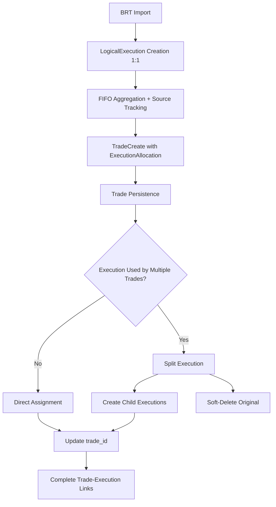

# Technical Design: Split-Aware Execution Linking

## Context

The Trade Sensei system has two import pipeline paths:

1. **Raw Pipeline**: BRT → LogicalExecution → FIFO Aggregation → Trade (preferred)
2. **Legacy Pipeline**: Direct TradeCreate → Trade + synthetic LogicalExecution (fallback)

According to the simplified-execution-model, each trade should have its associated LogicalExecutions linked via the `trade_id` FK. However, the raw pipeline path creates trades without this back-linking.

## Architectural Decision: Split-Aware vs. Best-Effort Linking

### Option 1: Best-Effort Linking (❌ Rejected)
- Assign each execution to first trade it participates in
- Subsequent trades that use the same execution get no entry leg
- **Problem**: Incomplete trade analysis - missing entry legs in partial close scenarios

### Option 2: Closing-Only Linking (❌ Rejected)  
- Only link executions with `pnl != NULL` (exit legs)
- Leave opening legs unlinked
- **Problem**: Missing entry legs for all trades

### Option 3: Split-Aware Linking (✅ **Chosen**)
- Automatically split executions when they contribute to multiple trades
- Each trade gets its own execution leg with correct quantity allocation
- Maintains broker integrity via `parent_id` lineage
- **Advantage**: Complete, accurate trade analysis capabilities

## Data Flow Design



## Core Data Structures

### ExecutionAllocation

Tracks how much of an execution is consumed by each trade:

```python
@dataclass
class ExecutionAllocation:
    execution_id: uuid.UUID      # Source LogicalExecution
    quantity_used: Decimal       # Portion allocated to this trade
    commission_used: Decimal     # Proportional commission
    entry_price: Decimal         # Execution price
```

### TradeCreateWithSources

Enhanced TradeCreate that tracks its source executions:

```python  
@dataclass
class TradeCreateWithSources:
    trade_create: TradeCreate
    source_executions: List[ExecutionAllocation]
    created_trade: Trade | None = None  # Set after DB insert
```

### Position Grouping + Metadata Propagation Model

To preserve user intent across technical FIFO splits, introduce a stable grouping concept at trade level.

```python
@dataclass
class PositionContext:
    position_id: uuid.UUID
    symbol: str
    account_id: uuid.UUID
    opened_at: datetime
    closed_at: datetime | None
```

Metadata fields subject to propagation within a `position_id` group:

- `playbook_id`
- `tags`
- `notes`
- `user_rating`

Propagation rules:

1. **Create-time inheritance**: New split-derived child trades inherit metadata snapshot from the active position context.
2. **Update-time propagation**: User metadata edits on one trade propagate to all active group members (same `position_id`) unless explicitly overridden in a future phase.
3. **Deterministic source of truth**: Latest user-authored value in group wins, with operation timestamp ordering.

## Split Algorithm

### Detection Logic

An execution requires splitting when:
1. It participates in the creation of multiple `TradeCreate` objects
2. The total quantity used across all trades < original execution quantity

### Split Implementation

Following simplified-execution-model split conventions:

```python
async def _split_execution_for_trade(
    self,
    execution_id: uuid.UUID,
    quantity_for_trade: Decimal,
    trade_id: uuid.UUID
) -> LogicalExecution:
    
    original = await self._exec_repo.get_by_id(execution_id)
    
    # 1. Soft-delete original (preserves BRT link)
    await self._exec_repo.soft_delete(execution_id)
    
    # 2. Create child for this specific trade
    child_for_trade = LogicalExecution(
        **original.__dict__,  # Copy all fields
        id=new_uuid(),        # New primary key
        quantity=quantity_for_trade,
        commission=proportional_commission,
        origin=EXECUTION_ORIGIN_SPLIT,
        parent_id=original.id,  # Lineage tracking
        trade_id=trade_id,      # Assignment to trade
        deleted=False
    )
    
    # 3. Create remainder child (for future allocation)
    remainder = LogicalExecution(
        **original.__dict__,
        id=new_uuid(),
        quantity=original.quantity - quantity_for_trade, 
        commission=original.commission - proportional_commission,
        origin=EXECUTION_ORIGIN_SPLIT,
        parent_id=original.id,
        trade_id=None,         # Available for next trade
        deleted=False
    )
    
    return child_for_trade
```

## Integration Points

### 1. Aggregator Enhancement

**File**: `app/utils/parsers/aggregator.py`

Modify `aggregate_executions_fifo()` to track execution usage:

```python
# During FIFO matching loop
while exec_qty_remaining > Decimal("0") and queue:
    open_lot = queue[0]
    match_qty = min(open_lot.quantity, exec_qty_remaining)
    
    # Track allocation
    allocation = ExecutionAllocation(
        execution_id=exec_trade.source_execution_id,  # New field
        quantity_used=match_qty,
        commission_used=proportional_commission,
        entry_price=exec_trade.entry_price
    )
    
    closed_trade = TradeCreateWithSources(
        trade_create=build_trade_create(...),
        source_executions=[allocation]
    )
```

### 2. Import Service Integration

**File**: `app/services/import_service.py`

Insert backfilling step after trade creation:

```python
# Raw pipeline (line ~362)
trades_with_sources = []
for trade_source in parsed_trades_with_sources:
    created_trade = await self._trade_repo.create(trade_source.trade_create)
    trade_source.created_trade = created_trade
    trades_with_sources.append(trade_source)

# NEW: Backfill execution links
await self._backfill_execution_trade_links(trades_with_sources, user_id)
```

Add post-linking metadata propagation + position assignment:

```python
# NEW: assign stable position_id to related trades
await self._assign_position_context(trades_with_sources, user_id, account_id)

# NEW: propagate metadata from parent/active position state
await self._propagate_trade_metadata(position_id_groups, user_id)
```

### 2.1 Trade Service Integration (metadata updates)

When users modify trade metadata during an open position lifecycle:

```python
async def update_trade_metadata(...):
    updated = await self._trade_repo.update_metadata(...)
    await self._trade_repo.propagate_metadata_to_position_group(
        position_id=updated.position_id,
        metadata=extract_propagatable_fields(updated),
        exclude_trade_id=None,
    )
```

This ensures a day-10 partial-close edit retrofits day-1/day-5 sibling trades in the same business position.

### 3. Execution Repository Enhancement

**File**: `app/repositories/execution.py`

Add trade_id update method:

```python
async def update_trade_id(
    self, 
    execution_id: uuid.UUID, 
    trade_id: uuid.UUID
) -> bool:
    stmt = (
        update(LogicalExecution)
        .where(LogicalExecution.id == execution_id)
        .values(trade_id=trade_id)
    )
    result = await self.session.execute(stmt)
    return bool(result.rowcount > 0)
```

## Error Handling

### Quantity Validation

Before any split operation:

```python
def validate_split_quantities(
    original_qty: Decimal, 
    allocations: List[ExecutionAllocation]
) -> None:
    total_used = sum(a.quantity_used for a in allocations)
    if total_used > original_qty:
        raise ValueError(f"Allocation overflow: {total_used} > {original_qty}")
```

### Orphaned Remainder Protection

Ensure no execution children are left without trade assignment:

```python
async def cleanup_orphaned_execution_children(
    self, 
    user_id: uuid.UUID,
    account_id: uuid.UUID
) -> int:
    """Find and resolve execution children with trade_id=NULL after import."""
    orphaned = await self._exec_repo.find_orphaned_children(user_id, account_id)
    
    for orphan in orphaned:
        # Try to match with open trades or create orphaned lots
        await self._resolve_orphaned_execution(orphan)
```

### Metadata Conflict Handling

If two updates race on the same `position_id` metadata set:

- apply last-write-wins by `updated_at`
- persist audit event `trade_metadata.propagated`
- log non-sensitive conflict details (`position_id`, `field_names`, timestamps)

## Performance Considerations

### Optimization Strategies

1. **Batch Operations**: Group execution updates by trade_id for bulk UPDATE queries
2. **Lazy Loading**: Only load execution details when splitting is required  
3. **Early Exit**: Skip allocation tracking for trades with single-execution sources
4. **Parallel Processing**: Process non-dependent trades concurrently

### Performance Monitoring

```python
import time
from functools import wraps

def track_performance(operation_name: str):
    def decorator(func):
        @wraps(func)
        async def wrapper(*args, **kwargs):
            start = time.time()
            result = await func(*args, **kwargs)
            elapsed = time.time() - start
            logger.info(f"{operation_name} completed in {elapsed:.2f}s")
            return result
        return wrapper
    return decorator

@track_performance("split_aware_linking")
async def _backfill_execution_trade_links(self, ...):
    # Implementation with timing
```

## Testing Strategy

### Unit Test Coverage

1. **Split Detection Logic**: Test when executions should/shouldn't be split
2. **Quantity Allocation**: Test proportional quantity and commission distribution
3. **Lineage Tracking**: Test `parent_id` relationships are correctly maintained
4. **Edge Cases**: Test single-execution trades, orphaned lots, zero quantities

### Integration Test Coverage

1. **End-to-End Import**: Test complete flow from BRT → linked executions
2. **API Response**: Test `/api/v1/trades/{id}/executions` returns complete legs
3. **UI Rendering**: Test ExecutionLegsTable displays entry/exit legs correctly
4. **Performance**: Test import times with large files remain acceptable
5. **Metadata continuity**: Test split-derived trades inherit and retain metadata
6. **Open-position propagation**: Test delayed metadata edits propagate to all position siblings

### New Scenario Coverage

1. **Day-1 Entry + Day-10 Partial Exit**
   - Set playbook/tags on entry
   - Perform delayed metadata edit on partial-close trade
   - Verify all same-position trades converge to updated metadata
2. **Three-way split with notes/rating**
   - Verify notes and rating are inherited for all split children
3. **Closed position boundary**
   - Ensure metadata propagation does not leak across different positions with same symbol

### Test Data Requirements

Add specific scenarios to test data:

- **Partial Closes**: 100 → 60 + 40 closing sequence
- **Multiple Partials**: 100 → 30 + 30 + 40 closing sequence  
- **Combo Trades**: Multi-leg option spreads
- **Stock Splits**: Corporate actions affecting open positions
- **Mixed Scenarios**: Combination of above with normal round-trips

## Risk Mitigation

### Data Integrity Risks

**Risk**: Split operations could corrupt execution lineage
**Mitigation**: Comprehensive validation + transaction rollback on failure

**Risk**: Import performance degradation
**Mitigation**: Performance testing + async processing + early optimization

**Risk**: Complex debugging of split execution trees
**Mitigation**: Enhanced logging + admin tools for lineage visualization

### Rollback Strategy

If split-aware linking causes issues:

1. **Code Rollback**: Revert to best-effort linking implementation
2. **Data Recovery**: Fresh import with fallback strategy
3. **Progressive Rollout**: Enable split-aware linking per account with feature flag
